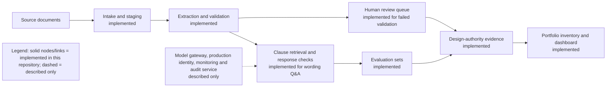

# Synthetic Insurance AI Architecture Prototype

**Personal prototype. Simulated reinsurer. Synthetic data. Illustrative policies and metrics.** This repository demonstrates two small working use cases and an enterprise-architecture practice around them. It is not a production underwriting or wording system. It contains no real company data, no production integrations, and no regulatory guidance. Any regulatory or Responsible-AI references are illustrative mappings, not statements of requirements.

## What it demonstrates

- Deterministic intake of synthetic submission documents, fixed-schema extraction, validation reason codes and human-review routing.
- Clause retrieval over synthetic wording documents, clause-ID citations, explicit insufficient-evidence and wrong-contract declines, and version-conflict detection.
- Field-level and question-set evaluation against author-labelled expected results. The label sets are intentionally small and do not establish production performance.
- Reference architecture, standards, design-authority gates, decision records, responsible-AI controls and a synthetic AI inventory with portfolio insight.
- A static dashboard at `docs/index.html`, generated from a deterministic renderer for local preview or static hosting.

## Conceptual layer view

Synthetic roles and data; illustrative.



The diagram is conceptual: the two use cases are separate local flows. The optional model gateway and production services are not implemented.

## Run locally

Requirements: Python 3.11 or later. The default mode uses only the Python standard library and makes no network calls or model calls. Development tests use pytest.

```powershell
python -m insure_ai intake
python -m insure_ai intake-eval
python -m insure_ai ask "What is the hours clause for TREATY-ALPHA V1?"
python -m insure_ai qa-eval
python -m insure_ai review
python -m insure_ai inventory
python -m insure_ai dashboard
python -m pytest -q
```

`dashboard` regenerates `docs/index.html`; open that file in a browser. Each CLI result is prefixed with a synthetic-data notice.

## Repository map

- `insure_ai/`: deterministic extractors, retrieval, evaluation, design-authority rules, inventory analysis and dashboard renderer.
- `data/`: labelled synthetic submissions, wordings, evaluation questions, controls, inventory and review criteria.
- `docs/`: reference architecture, principles, design-authority process, decision records, evaluation standard and computed findings.
- `tests/`: behavior, guardrail, consistency, documentation and firm-neutrality checks.

## Boundaries

The prototypes do not bind coverage, accept submissions, interpret a real contract, decide a claim, determine pricing, or replace professional review. The wording answer is limited to retrieved synthetic clauses. A conflict is surfaced rather than resolved. There is no real model integration, cloud service, broker connectivity, PII processing, production identity, MLOps or production monitoring. Architecture content marked “described only” is a target pattern for discussion, not delivered capability.

All figures and policies are invented. No measured outcome is claimed beyond calculations over the repository's synthetic data. The small author-labelled sets are demonstrations, not statistically representative evaluations.
