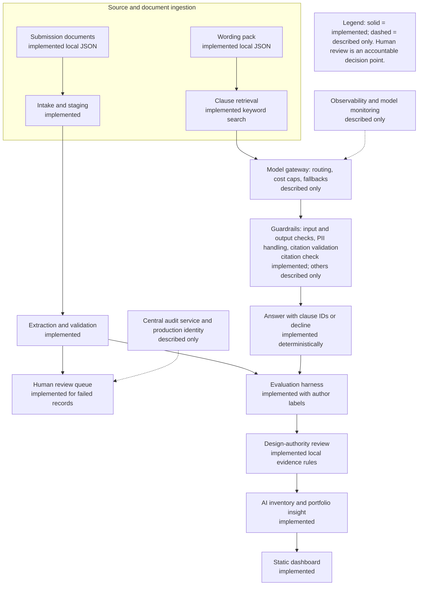
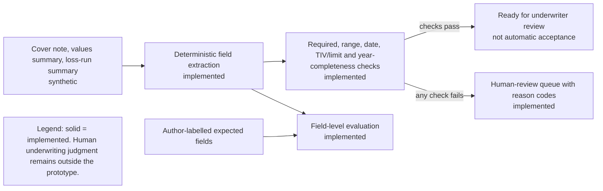
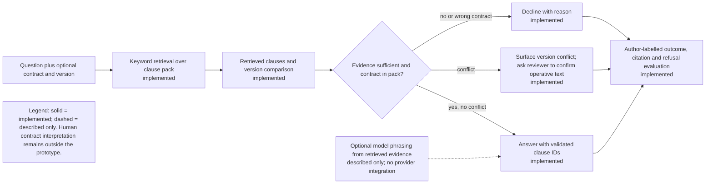

# Reference Architecture

Synthetic roles and data; illustrative. This document separates components implemented in the repository from production architecture described only. Any regulatory or Responsible-AI mapping is illustrative, not a statement of requirements.

## Enterprise AI layer view

## Submission intake

## Wording Q&A

## Component inventory

| Layer | Implemented | Described only |
|---|---|---|
| Ingestion | Local synthetic JSON documents | Broker uploads, malware scanning, document storage |
| Extraction and validation | Deterministic parsing and business-rule checks | OCR, document classification, confidence model |
| Retrieval | Standard-library keyword retrieval | Managed vector store, embeddings and hybrid search |
| Model gateway | None | Model routing, rate/cost caps, fallback and provider abstraction |
| Guardrails | Citation-ID validation and wrong-contract / insufficient-evidence declines | PII detection, prompt-injection controls, managed policy enforcement |
| Evaluation | Labelled sample evaluation for fields, outcomes, citations and refusals | Continuous evaluation, drift, robustness and security suites |
| Human review | Failed intake queue output; wording conflict surfaced | Workflow platform, notifications, role entitlements and SLA operation |
| Observability | CLI evaluation reports | Traces, latency/cost telemetry, alerting and model monitoring |
| Audit | Evaluation and review outputs | Centralized immutable audit platform and retention controls |
| Portfolio | Synthetic inventory analytics and static dashboard | Enterprise repository integration and authoritative ownership |
